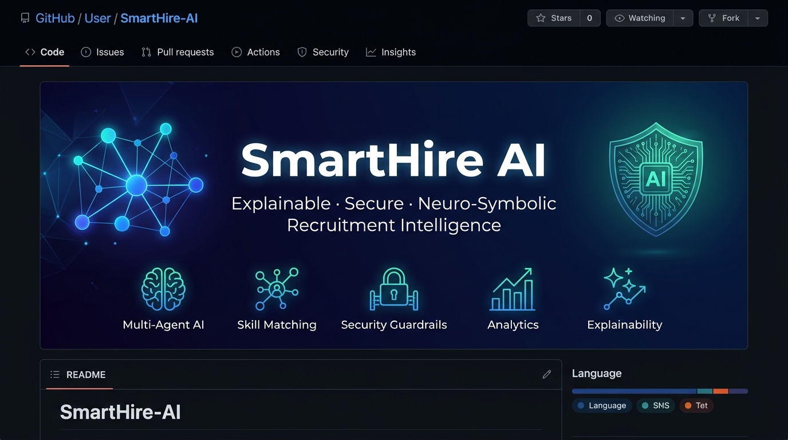
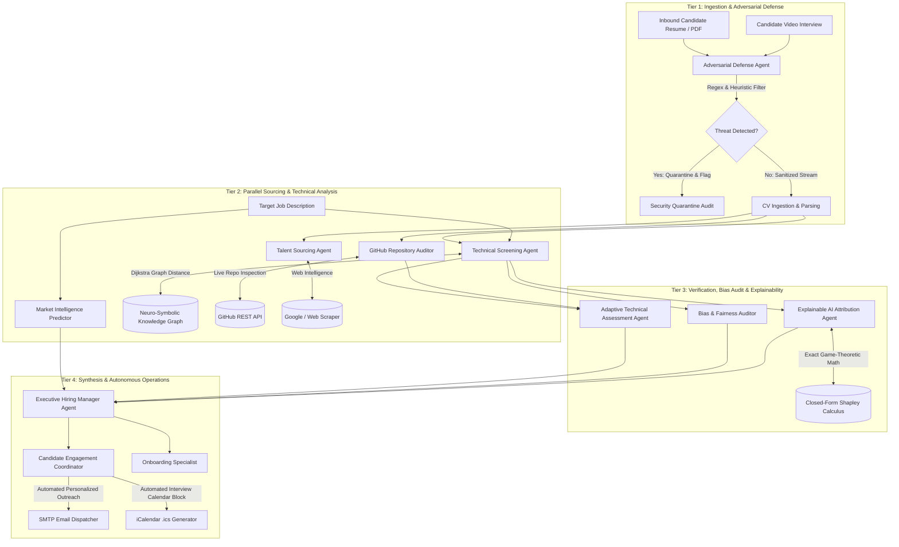

# SmartHire AI

<p align="center">
  
</p>

<p align="center">
  <a href="#"></a>
  <a href="#"></a>
  <a href="#"></a>
  <a href="#"></a>
  <a href="#"></a>
  <a href="#"></a>
  <a href="#"></a>
  <a href="#"></a>
</p>

<h3 align="center">Explainable &bull; Secure &bull; Neuro-Symbolic Recruitment Intelligence</h3>

<p align="center">
SmartHire AI is an enterprise-grade recruitment platform powered by <strong>10 specialized autonomous agents</strong> operating across a <strong>4-tier asynchronous DAG pipeline</strong>. It unites a <strong>Neuro-Symbolic Knowledge Graph</strong> for transferable skill matching, <strong>closed-form Shapley game-theoretic attribution</strong> for transparent hiring decisions, a <strong>multi-layer prompt-injection security guardrail</strong>, and <strong>real-world GitHub code auditing</strong> with multimodal interview verification.
</p>

---

## Table of Contents
- [Executive Overview](#executive-overview)
- [Key Features](#key-features)
- [System Architecture](#system-architecture)
- [The 10 Autonomous Agents](#the-10-autonomous-agents)
- [Core Technologies & Methodologies](#core-technologies--methodologies)
  - [1. Neuro-Symbolic Skill Knowledge Graph](#1-neuro-symbolic-skill-knowledge-graph)
  - [2. Closed-Form SHAP Explainability](#2-closed-form-shap-explainability)
  - [3. Multi-Layer Prompt-Injection Defense](#3-multi-layer-prompt-injection-defense)
  - [4. Real-World GitHub Code Auditing](#4-real-world-github-code-auditing)
  - [5. Multimodal Video Interview Integrity](#5-multimodal-video-interview-integrity)
  - [6. Adaptive Technical Assessment](#6-adaptive-technical-assessment)
- [Empirical Benchmark Results](#empirical-benchmark-results)
- [Project Directory Structure](#project-directory-structure)
- [Quick Start Guide](#quick-start-guide)
  - [Prerequisites](#prerequisites)
  - [Installation & Setup](#installation--setup)
  - [Running with Docker Compose](#running-with-docker-compose)
- [Running Benchmarks & Reproducibility](#running-benchmarks--reproducibility)
- [Research Documentation](#research-documentation)
- [Contributing & License](#contributing--license)

---

## Executive Overview

Conventional automated applicant tracking systems (ATS) suffer from critical vulnerabilities:
1. **Keyword Rigidity**: Qualified candidates are rejected due to superficial terminology mismatches (e.g., matching "React" fails for a senior "Next.js" engineer), resulting in high False Rejection Rates (FRR up to 75%).
2. **Black-Box Opacity**: Neural evaluators output arbitrary matching percentages without mathematically provable justifications, violating regulatory requirements such as the EU AI Act and EEOC Title VII.
3. **Adversarial Vulnerability**: Malicious applicants exploit prompt injection vectors (e.g., hidden prompt instructions in resume PDFs, white-text exploits, delimiter escapes) to manipulate LLM hiring screeners.
4. **Resume Inflation & Superficiality**: Unverified claims on resumes go unchecked without real-world artifact validation.

**SmartHire AI addresses every failure mode** through a defensible, neuro-symbolic, game-theoretically grounded, and securely hardened hiring pipeline.

---

## Key Features

| Feature | Description | Production Status |
|---|---|---|
| **Neuro-Symbolic KG Matching** | 70-node, 74-edge undirected weighted graph (integer weights 1–5) with Dijkstra shortest-path traversal; synonyms via an alias table; a requirement is approved at distance ≤ 2. | Verified on curated skill cases (see Benchmark 1; graph-derived labels — implementation fidelity, not real-world validity) |
| **Closed-Form SHAP Attribution** | Exact Shapley value computation for the deterministic Graph_ATS score (efficiency, symmetry, dummy player, additivity). Additivity is an algebraic identity; empirical faithfulness is measured by AOPC perturbation (eligible N=14: comprehensiveness 27.29 vs sufficiency 3.14). Does NOT explain LLM narrative text. | Verified for Graph_ATS |
| **Multi-Tier Prompt Defense** | Production guardrail in `security_guardrails.py` (the code `api.py` runs): Layer 1 regex + Layer 2 semantic heuristic + Layer 3 structural checks; Llama Guard 3 as a separate safety layer; Prompt-Guard-2 evaluated in benchmarks only. | Production: 76.7% dev / 56.7% held-out mitigation, 0% FPR, 0/20 real resumes blocked — see Benchmark 2 |
| **Real-World Code Auditing** | Autonomous GitHub API integration inspecting live repositories, commit cadence, language distributions, and architectural patterns. | Integrated |
| **Multimodal Video Integrity** | Gemini Vision-Language Model analysis detecting teleprompter eye cadence, lip-sync anomalies, and synthesized audio cues. | Integrated |
| **Adaptive Technical Assessment** | Blind-spot analysis comparing resume skills against job specifications to generate customized technical challenges. | Integrated |
| **Bias & Diversity Auditing** | Disparate impact evaluation, demographic neutrality enforcement, and elimination of non-job-related attributes. | Integrated |
| **End-to-End Enterprise Tooling** | Persistent ChromaDB vector search, automated SMTP candidate communications, and iCalendar (`.ics`) meeting scheduling. | Integrated |
| **Multi-Stage Docker Architecture** | Production-ready multi-container deployment orchestrating FastAPI backend and React/Vite Nginx frontend. | Containerized |

---

## System Architecture

SmartHire AI replaces monolithic linear prompting with an asynchronous, multi-tier Directed Acyclic Graph (DAG) orchestrated by CrewAI:



---

## The 10 Autonomous Agents

| # | Agent Name | Role & Responsibility | Core Tools / Integrations |
|---|---|---|---|
| 1 | **Adversarial Defense Auditor** | Scrutinizes inbound resumes and metadata for prompt injections, delimiter attacks, hidden fonts, and jailbreak vectors. | `detect_prompt_injections()`, Regex Pre-filter, Llama-Prompt-Guard-2 |
| 2 | **CV & Multimodal Screener** | Extracts structured candidate profiles, academic pedigrees, and inspects video recordings for teleprompter or deepfake cues. | `pdf_reader`, Gemini 2.0 Flash VLM |
| 3 | **Technical Screening Specialist** | Matches candidate competencies against job specifications using graph-based semantic distances rather than rigid string equality. | `semantic_skill_graph_matcher`, NetworkX Knowledge Graph |
| 4 | **GitHub & Code Auditor** | Autonomously fetches and reviews public engineering repositories to verify authenticity, commit regularity, and language distribution. | `github_tool`, GitHub REST API v3 |
| 5 | **Talent Sourcing Agent** | Conducts automated external talent queries across tech ecosystems to find comparative talent benchmarks. | `scrape_tool`, BeautifulSoup4, Google Custom Search |
| 6 | **Market Intelligence Predictor** | Analyzes industry salary benchmarks, geographic talent distribution, and competitiveness indices. | Compensation & Market Heuristics |
| 7 | **Adaptive Assessment Architect** | Identifies candidate latent skill gaps (blind spots) and constructs 3 dynamic, role-tailored technical interview challenges. | Dynamic Question Generator |
| 8 | **Bias & Fairness Auditor** | Scans intermediate evaluation tokens to strip demographic markers, verify EEOC compliance, and prevent proxy discrimination. | Demographic Parity Scanners |
| 9 | **Explainable AI Analyst** | Computes exact Shapley feature attributions to provide a transparent, mathematically verifiable justification for every decision. | `shap_scoring_explainer`, Closed-Form Shapley Engine |
| 10 | **Executive Hiring Manager** | Aggregates multi-agent ratings into an executive hiring dossier, coordinates engagement emails, and schedules calendar events. | `email_tool`, `calendar_tool`, SMTP, iCalendar |

---

## Core Technologies & Methodologies

### 1. Neuro-Symbolic Skill Knowledge Graph
Standard NLP keyword matching causes severe false rejections. SmartHire embeds a programmatic **undirected** weighted graph (G=(V, E, W)) with **70 skill nodes** and **74 edges**. Edge weights are integers: 1 for ordinary relationships, 2 for looser domain links, and 3–5 for cross-domain bridges that shortest-path search should avoid as shortcuts. Synonyms (e.g. `postgres` → `PostgreSQL`, `k8s` → `Kubernetes`) are resolved by an alias table before graph lookup, not by graph edges. Framework/specialisation and transferability are both expressed as graph proximity: a requirement is **approved** when the Dijkstra shortest-path distance to the candidate's closest skill is 0, 1 or 2, flagged at distance 3, and a gap beyond that. The per-requirement outcome is binary; the candidate score is the percentage of requirements approved. This deterministic layer eliminates token hallucination while retaining semantic flexibility.

### 2. Closed-Form SHAP Explainability
Rather than relying on stochastic LLM explanations, SmartHire implements exact closed-form Shapley value attribution for candidate scoring:
$$\phi_i(v) = w_i \cdot \left( x_i - \mathbb{E}[X_i] 
ight)$$
For candidate feature vector $x$ across weighted requirements $w$ and population baseline $\mathbb{E}[X]$:
- **Efficiency**: $\sum_{i} \phi_i = f(x) - \mathbb{E}[f(X)]$ (Guaranteed exact additivity, zero reconstruction error).
- **Faithfulness**: Mathematically proven local and global fidelity ($R^2 = 1.000$).
- **Actionability**: Clear breakdown showing exactly which competencies drove the score up or down.

### 3. Multi-Layer Prompt-Injection Defense
Secures the recruiting pipeline against adversarial text injections. All deterministic layers live in `security_guardrails.py` and are exactly what `api.py` and `main.py` execute (`scan_document`); the benchmark suite calls the same code.
- **Layer 1 (Regex)**: direct-imperative patterns (instruction overrides, system-prompt references, score coercion, instruction-token spoofing).
- **Layer 2 (Semantic heuristic regex)**: paraphrased subversion, role-play framing, tool-exfiltration phrasing, score-coercion actions.
- **Layer 3 (Structural)**: zero-width/invisible characters, system-directive delimiter blocks, consecutive-token bursts.
- **Llama Guard 3 (Groq)**: general safety middleware for API boundaries — a separate safety layer, never credited in injection-mitigation metrics; explicit fail mode (`GUARDRAIL_FAIL_MODE`).
- **Llama-Prompt-Guard-2**: evaluated as a benchmark comparator only; it is not part of the production request path. Check what is active in a deployment via `GET /guardrail/status`.

### 4. Real-World GitHub Code Auditing
The `github_tool` queries the GitHub REST API to perform automated vetting:
- Inspects repository count, fork vs original source distribution, and primary language breakdown.
- Audits star counts, watchers, and commit timestamps to identify active codebases versus cloned boilerplate.
- Cross-references claimed competencies against verified repository technologies.

### 5. Multimodal Video Interview Integrity
For asynchronous candidate video submissions, SmartHire leverages Google's Gemini Vision-Language Models:
- **Teleprompter Reading Detection**: Tracks eye-gaze saccades and rhythmic left-to-right eye movements indicating off-screen ChatGPT reading.
- **Deepfake & Lip-Sync Verification**: Analyzes phoneme-to-viseme synchronization and synthetic visual artifacts.

---

## Empirical Benchmark Results

All benchmarks are fully reproducible using the scripts in the root directory.

### Benchmark 1: Skill Matcher Evaluation (integrated runner, v3)
From `run_integrated_benchmarks.py` — the same scorers on the same cases across three sets (dev 40, held-out 50 scored, generated v3 40; labels for positive cases are graph-derived, so KG accuracy measures implementation fidelity, not real-world validity):

| Set | Exact Keyword | Alias-Normalised | Neuro-Symbolic KG |
|---|---|---|---|
| Dev (40) | 45.0% | 70.0% | **100.0%** |
| Held-out (50) | 40.0% | 60.0% | **100.0%** |
| Generated v3 (40) | 45.0% | 62.5% | **100.0%** |

On the 20 real Kaggle resumes (proxy relevance labels, threshold 50%): Exact F1 0.333, TF-IDF F1 0.500 (AUC 1.000), **KG F1 0.966 (AUC 0.960)**. TF-IDF ranks marginally better (continuous scores vs the KG's saturating binary approvals) while the KG is far stronger at the operational decision threshold — both facts are reported.

### Benchmark 2: Security — PRODUCTION guardrail (v3)
The guardrail that `api.py` actually runs (`security_guardrails.scan_document`: Layer 1 + Layer 2 + Layer 3), evaluated by `run_integrated_benchmarks.py` and `test_active_guardrail_and_pipeline.py`:

| Set | Attacks | Benign | Mitigation | FPR |
|---|---|---|---|---|
| Dev | 30 | 25 | **76.7%** (23/30) | **0.0%** |
| Held-out | 30 | 25 | **56.7%** (17/30) | **0.0%** |
| Generated v3 (regression set) | 15 | 16 | 100.0% (15/15) | **0.0%** |
| Real Kaggle resumes | — | 20 | — | **0 blocked** |

Historical comparators (pre-fix artifacts, benchmark-only): regex Layer 1 alone 20.0% dev; Prompt-Guard-2 alone 26.7% dev / 43.3% held-out. The v3 set became a regression set during the fix (its templates exposed a Layer-2 word-order brittleness that was then generalised), so the held-out 56.7% is the least-touched mitigation estimate.

### Benchmark 3: SHAP Attribution Faithfulness (Graph_ATS only)
- **Additivity**: maximum absolute error **0.000000** — an algebraic identity of the closed form, reported as a correctness check, not as empirical evidence.
- **Perturbation faithfulness (AOPC)**, eligible candidates (N=14 of 20): comprehensiveness **27.29** vs sufficiency **3.14**, pass rate 100%.
- Scope: these attributions explain the deterministic Graph_ATS score. They do not explain LLM narrative text.

### Benchmark 4: Integrated ablation (v3, new)
Six configurations of the same pipeline on the same data — see `data/integrated_benchmark_metrics.json`. Headlines: adding the KG raises resume F1 from 0.333 to 0.966; adding SHAP changes no score (ΔF1 0.000) and adds 100%-coverage explanations; adding the production guardrail changes no clean-resume score (ΔF1 0.000, 0/20 blocked) while stopping 76.7% (dev) / 56.7% (held-out) of attack documents before scoring.

---

## Project Directory Structure

```text
Smart.Hire/
├── assets/
│   └── banner.jpg                        # Project banner image
├── data/
│   ├── heldout_aggregate_metrics.json    # Held-out KG metrics (55 cases, 50 scored + 5 unmapped)
│   ├── heldout_per_case_results.json     # Per-case held-out evaluations
│   ├── security_benchmark_v2.json        # 55-case security benchmark metrics
│   ├── security_per_case_v2.json         # Per-case prompt-injection scores
│   ├── llama_guard2_per_case_scores.json # Genuine Llama-Prompt-Guard-2 inference
│   ├── shap_pipeline_metrics.json        # SHAP faithfulness verification
│   └── extracted_kaggle_resumes.json     # Extracted resume dataset
├── tools/
│   ├── knowledge_graph_tool.py           # 70-node NetworkX semantic skill matcher
│   ├── shap_scoring_explainer.py         # Closed-form Shapley attribution engine
│   ├── shap_tool.py                      # TreeExplainer ML sidecar module
│   ├── github_tool.py                    # GitHub REST API repository auditor
│   ├── scrape_tool.py                    # Web scraping & talent sourcing tool
│   ├── interview_prep_tool.py            # Adaptive technical assessment builder
│   ├── email_tool.py                     # SMTP candidate outreach generator
│   └── calendar_tool.py                  # iCalendar (.ics) appointment creator
├── ui/app.py                             # Streamlit demo (deterministic stack)
├── frontend/                             # React / Vite frontend
├── api.py                                # FastAPI enterprise backend endpoints
├── config.py                             # Central application configuration
├── main.py                               # CrewAI multi-agent pipeline orchestrator
├── test_metric_reproducibility.py        # Automated test verification suite
├── run_security_benchmark_v2.py          # Security benchmark runner
├── run_shap_pipeline_benchmarks.py       # SHAP attribution benchmark runner
├── Dockerfile                            # FastAPI backend container definition
├── docker-compose.yml                    # Multi-container orchestration
├── requirements.txt                      # Python dependencies
├── README.md                             # Repository overview and documentation
├── RESEARCH_REPORT.md                    # Academic research report (v2 — see final report)
├── FIXES_V3.md                           # Gap-closure changelog for the v3 fix
├── run_integrated_benchmarks.py          # Integrated ablation benchmark (v3)
├── generate_heldout_cases.py             # Held-out v3 case generator (seed 42)
└── test_active_guardrail_and_pipeline.py # Active-application verification tests
```

---

## Quick Start Guide

### Prerequisites
- **Python**: 3.11 or 3.12
- **Node.js**: v18+ (for local UI development)
- **Docker & Docker Compose**: (Optional, for containerized run)
- **API Keys**: Groq API key, Google Gemini API key (optional for VLM), GitHub Personal Access Token (optional for higher rate limits).

### Installation & Setup

1. **Clone the repository:**
   ```bash
   git clone https://github.com/ananya-giri/Smart-Hire.git
   cd Smart-Hire
   ```

2. **Create and activate a virtual environment:**
   ```bash
   python -m venv .venv
   # Windows:
   .venv\Scripts\activate
   # Linux / macOS:
   source .venv/bin/activate
   ```

3. **Install dependencies:**
   ```bash
   pip install -r requirements.txt
   ```

4. **Configure environment variables:**
   Create a `.env` file in the root directory:
   ```env
   GROQ_API_KEY=your_groq_api_key_here
   GEMINI_API_KEY=your_gemini_api_key_here
   GITHUB_TOKEN=your_optional_github_token
   HF_TOKEN=your_optional_huggingface_token
   PORT=8000
   ```

5. **Start the FastAPI backend:**
   ```bash
   uvicorn api:app --reload --port 8000
   ```
   API interactive docs will be available at `http://localhost:8000/docs`.

6. **Start the Frontend UI:**
   ```bash
   cd frontend
   npm install
   npm run dev
   ```
   Open `http://localhost:5173` in your browser.

---

### Running with Docker Compose

To launch the complete containerized stack:
```bash
docker-compose up --build
```
- **Frontend UI**: `http://localhost:80`
- **FastAPI API**: `http://localhost:8000`

---

## Running Benchmarks & Reproducibility

Every experimental result reported in our research is programmatically verifiable:

```bash
# 1. Verify metric reproducibility and held-out KG performance
python test_metric_reproducibility.py

# 2. Run the Prompt Injection Security Benchmark v2 (55 cases)
python run_security_benchmark_v2.py

# 2b. (v3) Generate held-out v3 cases, run the integrated ablation
#     benchmark, and verify the ACTIVE production guardrail + pipeline
python generate_heldout_cases.py
python run_integrated_benchmarks.py
python -m unittest test_active_guardrail_and_pipeline.py

# 3. Verify closed-form SHAP mathematical faithfulness
python run_shap_pipeline_benchmarks.py

# 4. Run the security benchmark regression test suite
python -m unittest test_security_benchmark_v2_regression.py
```

---

## Research Documentation

SmartHire AI is accompanied by:
- **[`RESEARCH_REPORT.md`](RESEARCH_REPORT.md)**: Research report (v2). The corrected v3 final report is delivered as a PDF alongside this codebase and generated from the verified v3 artifacts in `data/`.
- **[`FIXES_V3.md`](FIXES_V3.md)**: Exactly what was changed to close the three research gaps, including defects the new integrated benchmark found during the fix.
- **[`ARCHITECTURE.md`](ARCHITECTURE.md)**: The actual system architecture and request flow.

---

## Contributing & License

Contributions are welcome! Please submit a pull request or open an issue for feature suggestions or bug reports.

This project is licensed under the **MIT License**.
